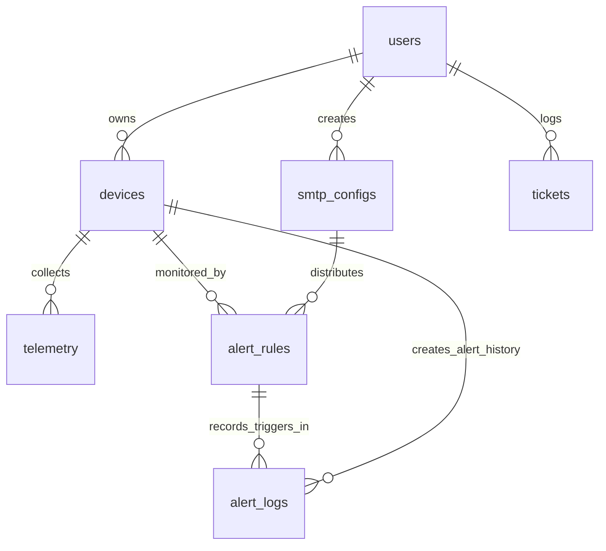
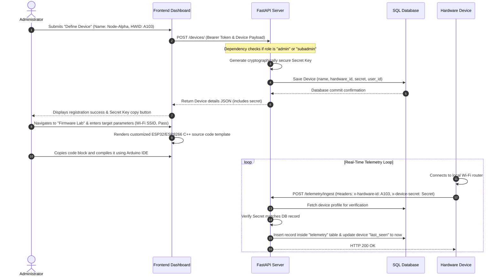
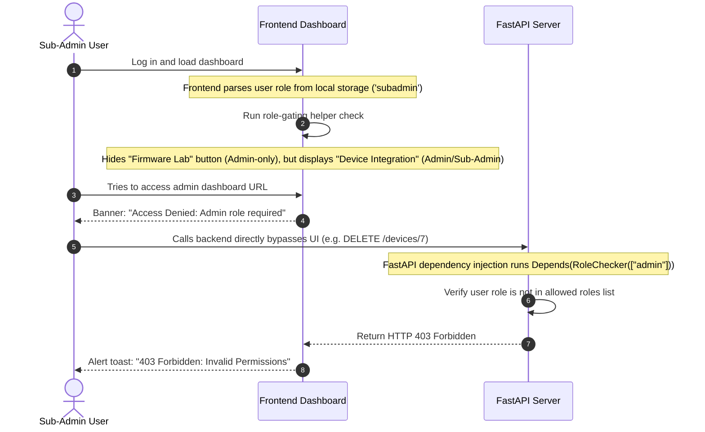

# 🛡️ IoT Guard - System Design & Architecture Document

A complete technical specification of the **IoT Guard (Hardware Monitoring System)** architecture, system modules, data schema, UI flow, and integration workflows.

---

## 🏛️ 1. High-Level Architecture Overview

IoT Guard is designed using a **Modular Monolith** pattern. It balances performance, simplicity, and decoupling of concerns across several system boundaries:

```text
                  ┌──────────────────────────────────────────────┐
                  │            GLASSMORPHIC FRONTEND SPA         │
                  │         (Vanilla HTML5, CSS3, JS ES6+)       │
                  └──────────────────────┬───────────────────────┘
                                         │
                   HTTP REST Requests &  │
                   JWT Bearer Auth       ▼
                  ┌──────────────────────────────────────────────┐
                  │                 FASTAPI BACKEND              │
                  │   ┌──────────────────────────────────────┐   │
                  │   │   Auth & Session Module              │   │
                  │   ├──────────────────────────────────────┤   │
                  │   │   Devices & Provisioning Module      │   │
                  │   ├──────────────────────────────────────┤   │
                  │   │   Telemetry Processing Module        │   │
                  │   ├──────────────────────────────────────┤   │
                  │   │   Alert Trigger & Cooldown Engine    │   │
                  │   ├──────────────────────────────────────┤   │
                  │   │   Support Ticketing Service          │   │
                  │   └──────────────────┬───────────────────┘   │
                  └──────────────────────┼───────────────────────┘
                                         │
                             SQLAlchemy  │  KV Client
                             ORM Query   │  Connection
                                         ▼
                  ┌──────────────────────┴───────────────────────┐
                  │              DATA PERSISTENCE LAYER          │
                  │  ┌──────────────────┐  ┌──────────────────┐  │
                  │  │ SQLite/PostgreSQL│  │ Redis Cache      │  │
                  │  │ (Relational DB)  │  │ (Session Store)  │  │
                  │  └──────────────────┘  └──────────────────┘  │
                  └──────────────────────────────────────────────┘
```

### 📡 Telemetry Ingestion Path
1. **HTTP Ingestion**: Microcontrollers push telemetry payloads directly over secure HTTPS POST to the backend endpoint `/telemetry/ingest`.
2. **MQTT Ingestion** (Provisioned): Telemetry publishes to `v1/devices/+/telemetry` on an **EMQX MQTT Broker**. An asynchronous worker thread consumes these events and populates the database.

---

## 🏗️ 2. Detailed Component Architecture

Detailed visualization of the client, ingestion, backend processing modules, database persistence layer, and external alert dispatch networks.

```mermaid
graph TD
    %% Styling Definitions
    classDef client fill:#3b82f6,stroke:#1d4ed8,stroke-width:2px,color:#fff;
    classDef broker fill:#f59e0b,stroke:#d97706,stroke-width:2px,color:#fff;
    classDef service fill:#8b5cf6,stroke:#6d28d9,stroke-width:2px,color:#fff;
    classDef db fill:#10b981,stroke:#047857,stroke-width:2px,color:#fff;
    classDef external fill:#ef4444,stroke:#dc2626,stroke-width:2px,color:#fff;

    subgraph CTR["Client Tier (Frontend SPA)"]
        UI["Glassmorphic UI (HTML/CSS/JS)"]
        CJ["Chart.js Runtime Engine"]
        API_CLR["REST API Consumer Client"]
        
        UI --> API_CLR
        UI --> CJ
    end
    class CTR client;

    subgraph ING["Ingestion & Broker Tier"]
        MCU["ESP32 / ESP8266 Microcontrollers"]
        EMQX["EMQX MQTT Broker (v5.0)"]
        
        MCU -->|"HTTP POST telemetry"| INGEST_EP["FastAPI Ingest Route"]

---

## 🧱 3. 8-Layer Enterprise Architecture

The platform architecture is designed using an structured 8-layer model, separating responsibilities from physical IoT devices up to the user interface.

```mermaid
graph TD
    %% Layer Custom Colors
    classDef layer1 fill:#ebf8ff,stroke:#bee3f8,stroke-width:2px,color:#2b6cb0;
    classDef layer2 fill:#f0fff4,stroke:#c6f6d5,stroke-width:2px,color:#22543d;
    classDef layer3 fill:#fffaf0,stroke:#feebc8,stroke-width:2px,color:#7b341e;
    classDef layer4 fill:#faf5ff,stroke:#e9d8fd,stroke-width:2px,color:#553c9a;
    classDef layer5 fill:#ebf8ff,stroke:#bee3f8,stroke-width:2px,color:#2b6cb0;
    classDef layer6 fill:#fff5f5,stroke:#fed7d7,stroke-width:2px,color:#9b2c2c;
    classDef layer7 fill:#f7fafc,stroke:#e2e8f0,stroke-width:2px,color:#4a5568;
    classDef layer8 fill:#fffff0,stroke:#fefcbf,stroke-width:2px,color:#744210;

    subgraph L1 ["1. PRESENTATION LAYER (Glassmorphic SPA)"]
        node_l1["Login/Register | Dashboard | Devices | Telemetry Graphs | Alerts | Tickets | Profile/Settings"]
    end
    class L1 layer1;

    subgraph L2 ["2. API GATEWAY / INTERFACE LAYER (FastAPI Backend)"]
        node_l2["Request Validation | JWT Authentication | Rate Limiting & Security | Routing to Modules"]
    end
    class L2 layer2;

    subgraph L3 ["3. APPLICATION / SERVICE LAYER (Business Modules)"]
        subgraph L3_auth ["auth"]
            auth_items["User Login<br/>Registration<br/>Role & Permission<br/>Session Mgmt"]
        end
        subgraph L3_devices ["devices"]
            dev_items["Device Onboarding<br/>Device Management<br/>Status & Config<br/>Firmware Info"]
        end
        subgraph L3_telemetry ["telemetry"]
            tel_items["Data Ingestion<br/>Validation<br/>Normalization<br/>Storage"]
        end
        subgraph L3_alerts ["alerts"]
            al_items["Rule Evaluation<br/>Threshold Check<br/>Cooldown Mgmt<br/>Alert Generation"]
        end
        subgraph L3_tickets ["tickets"]
            t_items["Create Ticket<br/>Assign<br/>Update<br/>Resolve"]
        end
    end
    class L3,L3_auth,L3_devices,L3_telemetry,L3_alerts,L3_tickets layer3;

    subgraph L4 ["4. CORE / SHARED LAYER (Core Packages)"]
        node_l4["config.py (Settings)<br/>database.py (SQLAlchemy/Session)<br/>redis.py (Redis/FakeRedis)<br/>security.py (JWT/Bcrypt)<br/>__init__.py (Imports)"]
    end
    class L4 layer4;

    subgraph L5 ["5. DATA ACCESS LAYER"]
        ORM["SQLAlchemy ORM (Models, CRUD, Transactions)"]
        RedisClient["Redis Client (Session Store, Cache, Pub/Sub future)"]
    end
    class L5 layer5;

    subgraph L6 ["6. DATA PERSISTENCE LAYER (Storage Systems)"]
        RDBMS["SQLite / PostgreSQL<br/>(Users, Devices, Telemetry, Alerts, Tickets, Logs)"]
        KV["Redis Cache<br/>(User Sessions, API Cache, Temp Data, Rate Limits)"]
    end
    class L6 layer6;

    subgraph L7 ["7. INFRASTRUCTURE LAYER (DevOps)"]
        node_l7["Docker Containers | Nginx Reverse Proxy | CI/CD Pipeline | Monitoring & Logging | Backup & Restore"]
    end
    class L7 layer7;

    subgraph L8 ["8. DEVICE / HARDWARE LAYER (IoT Hardware)"]
        node_l8["ESP32 / ESP8266 Devboards | Temperature, Humidity Sensors | WiFi / MQTT / HTTP Interfaces"]
    end
    class L8 layer8;

    %% Data Flow Dependencies
    L1 -->|"HTTP REST APIs + JWT Bearer"| L2
    L2 --> L3
    L3 --> L4
    L4 --> L5
    L5 --> L6
    L6 --> L7
    L7 -->|"MQTT / HTTP Data Protocol"| L8
```

### 🔍 Detailed Layer Breakdown
1. **Presentation Layer**: Client-facing tier utilizing Glassmorphic elements. Single Page Application built on HTML5, CSS3, and JavaScript, rendering parameters and Chart.js canvases. Responsive controls gate features using the user roles payload.
2. **API Gateway / Interface Layer**: Handles HTTP requests. Coordinates Pydantic request validations, JWT validation checks, path routing, and applies exceptions or rate gates before module routing.
3. **Application / Service Layer**: Modularity core of the backend system containing domain packages (`auth`, `devices`, `telemetry`, `alerts`, `tickets`). Encapsulates distinct CRUD helpers, database model models, routes definitions, and background event triggers.
4. **Core / Shared Layer**: Houses application configurations, database engine creations (`database.py`), Redis connection sessions (`redis.py`), password crypto schemes (`security.py`), and environments parsers (`config.py`).
5. **Data Access Layer**: Abstracted data operators interacting through SQLAlchemy ORM wrappers for relational SQL transactions and native Redis client connections for session tokens caching.
6. **Data Persistence Layer (Storage)**: Relational databases (SQLite in Dev, PostgreSQL in Prod) store persistent variables (users schema, device keys, telemetry telemetry, alerts records, and ticketing entries). Key-Value Cache engines store short-term sessions.
7. **Infrastructure / DevOps Layer**: Containerization and server layouts (Docker configs, Nginx reverse proxies, environment monitoring logs, CI/CD runners, dev server environment settings).
8. **Device / Hardware Layer**: Real physical microcontroller assets (ESP32/ESP8266) executing custom C++ code generated via frontend Firmware Lab. Measures local sensors (temperature, humidity), connects online, and posts telemetry payloads.

---

## 🛠️ 4. Technology Stack & Decision Rationale

| Component | Technology | Rationale & Operational Context |
| :--- | :--- | :--- |
| **Backend Engine** | **FastAPI** (Python 3.9+) | Built-in async capability (non-blocking I/O) handles concurrent telemetry streams cleanly. Automated schema validation via Pydantic. |
| **Frontend Framework** | **Vanilla JS (ES6+), HTML5, CSS3** | Zero build steps or compilation overhead. Instant local loads. Maintainable with pure semantic classes. |
| **Styling Concept** | **Glassmorphism Design** | High-end visual dashboard styling featuring modern color variables, deep shadows, blurred cards, and clean visual gradients. |
| **Relational DB** | **SQLAlchemy ORM** + SQLite/PostgreSQL | SQLite provides local plug-and-play simplicity. PostgreSQL supports robust concurrency, relational constraints, and scale in production. |
| **Session Cache** | **Redis** (Local or Cloud) | Caches user tokens. Built-in `FakeRedis` safe-fail ensures system stays online if Redis connectivity times out. |
| **Telemetry Ingest** | **EMQX Broker** / HTTP REST | Industry-standard MQTT broker for millions of light-weight sensor messages. |
| **Visualization** | **Chart.js** (v4.x) | Real-time browser rendering of multiple telemetry metrics on HTML canvas. |

---

## 🗄️ 5. Data Models & Database Schema

The database consists of relational tables connected through foreign keys. Relationships ensure consistency between users, their registered devices, telemetry data, alert rules, triggers, and support tickets.

### 5.1 Schema Relationship Map



### 5.2 Database Column Directory

#### 1. Users Table (`users`)
Stores user data, passwords, and security tiers.
- `id` (Integer, Primary Key)
- `email` (String, Unique, Indexed)
- `hashed_password` (String)
- `full_name` (String, Nullable)
- `role` (String, Default: `"user"`) — *Access control levels: `"admin"`, `"subadmin"`, `"user"`*
- `is_active` (Boolean, Default: `True`)

#### 2. Devices Table (`devices`)
Stores metadata about the registered microcontroller nodes.
- `id` (Integer, Primary Key)
- `hardware_id` (String, Unique, Indexed) — *Physical identifier chosen by user*
- `name` (String) — *Human readable tag*
- `secret` (String, Unique) — *32-digit string generated on creation to authorize payloads*
- `user_id` (Integer, Foreign Key to `users.id`) — *Designates device owner*
- `last_seen` (DateTime, Nullable) — *Updated on incoming telemetry packets*

#### 3. Telemetry Table (`telemetry`)
Stores raw sensor packets.
- `id` (Integer, Primary Key)
- `device_id` (Integer, Foreign Key to `devices.id`)
- `data` (JSON) — *Supports dynamic key-value pairs (e.g. `{"temp_0": 22.5, "humidity": 60}`)*
- `timestamp` (DateTime, Defaults to database timestamp on insert)

#### 4. SMTP Configurations (`smtp_configs`)
Stores connection details for outgoing alert notification routes.
- `id` (Integer, Primary Key)
- `user_id` (Integer, Foreign Key to `users.id`)
- `name` (String) — *Relay label*
- `from_email` (String) / `from_name` (String)
- `host` (String) — *SMTP server hostname (e.g. smtp.gmail.com)*
- `port` (Integer) — *e.g., 465, 587*
- `username` (String) / `password` (String) — *OAuth app-specific passwords*
- `security` (String, Default: `"TLS"`) — *`"TLS"`, `"SSL"`, `"None"`*
- `helo_ident` (String, Default: `"IoT-Guard-Node"`) — *Identifies routing name to SMTP server*
- `auth_type` (String, Default: `"Standard"`) — *`"None"`, `"Standard"`, `"SASL"`*
- `is_active` (Boolean, Default: `True`)

#### 5. Alert Rules Table (`alert_rules`)
Rules that evaluate telemetry payloads.
- `id` (Integer, Primary Key)
- `device_id` (Integer, Foreign Key to `devices.id`)
- `smtp_config_id` (Integer, Foreign Key to `smtp_configs.id`)
- `name` (String)
- `sensor_key` (String, Nullable) — *Value evaluated (e.g., `temp_0`)*
- `trigger_type` (String) — *`"state"` (sensor value monitoring) or `"heartbeat"` (online monitoring)*
- `condition_value` (Float, Nullable) — *Threshold limit or heartbeat timeout in minutes*
- `operator` (String, Nullable) — *`">"`, `"<"`, `"=="`, `"!="`*
- `recipients` (String) — *Comma-separated emails*
- `subject` (String) / `template` (Text) — *Dynamic variables parsed at runtime*
- `is_active` (Boolean, Default: `True`)
- `last_triggered` (DateTime, Nullable)
- `cooldown_seconds` (Integer, Default: `300`) — *Prevents spamming reports*

#### 6. Alert Log Table (`alert_logs`)
Maintains historical records of triggered events for incident management.
- `id` (Integer, Primary Key)
- `device_id` (Integer, Foreign Key to `devices.id`)
- `rule_id` (Integer, Foreign Key to `alert_rules.id`)
- `message` (Text)
- `status` (String, Default: `"Open"`) — *`"Open"`, `"Resolved"`, `"Acknowledged"`*
- `resolved_at` (DateTime, Nullable)
- `resolver_id` (Integer, Foreign Key to `users.id`, Nullable)
- `timestamp` (DateTime, Defaults to current time)

#### 7. Support Tickets Table (`tickets`)
Allows users to flag incidents or request system assistance.
- `id` (Integer, Primary Key)
- `device_id` (Integer, Foreign Key to `devices.id`, Nullable)
- `subject` (String)
- `description` (Text)
- `priority` (String, Default: `"Medium"`)
- `status` (String, Default: `"Open"`) — *`"Open"`, `"In Progress"`, `"Closed"`*
- `created_at` (DateTime)
- `updated_at` (DateTime)

---

## 📦 6. Domain Module Deep-Dive

### 🛡️ 6.1 Authentication Module (`app/modules/auth`)
Coordinates secure entry and user permission levels:
- **Hashing Security**: Bypasses `passlib` context helper due to conflicts with newer bcrypt libraries. Uses raw `bcrypt.checkpw()` on UTF-8 string conversions, limiting length to 72 bytes.
- **JWT Lifespans**: Encrypts authentication checks with dynamic signature. Extends access tokens to automatically sign out users after a 7-day expiration duration.
- **Role Administration Gating**: Enforces role scopes (`admin`, `subadmin`, or `user`) using a clean FastAPI dependency check: `RoleChecker(["allowed_role"])`.

### 🔌 6.2 Device Integration Module (`app/modules/devices`)
Enables provision logic and token verification:
- **Cryptographic Token Assignment**: Generates unique client secrets on new node registry using native `secrets.choice` algorithms for authentication safety.
- **Microcontroller Handshake Verification**: Compares the custom request headers `x-hardware-id` and `x-device-secret` before completing payload ingestion.

### 📊 6.3 Telemetry Ingestion Module (`app/modules/telemetry` & `app/modules/mqtt`)
Manages sensor streams in real-time:
- **Ingestion Flexibility**: Reads flat HTTP POSTs (e.g. `{"temp_0": 34}`) or nested packages (e.g. `{"data": {"temp_0": 34}}`).
- **MQTT Broker Daemon**: Uses internal async loop mapping to target EMQX broker topics `v1/devices/+/telemetry`. Telemetry messages are parsed and saved to the database. (Configured dynamically in startup).

### 🔔 6.4 Alerts & Scheduling Engine (`app/modules/alerts`)
Examines state records and sends warnings:
- **Evaluation Engine**: Inspects current metrics against stored alarm thresholds on every ingest event. Updates the rule status dynamically.
- **Heartbeat Daemon**: Runs every 60 seconds on a background loop checking if a device's `last_seen` timestamp has exceeded the maximum time specified in heartbeat rules.
- **Anti-Spam Cooldown Filter**: Checks differences between current timestamp and rule's `last_triggered` field to enforce cooldown intervals (default 300s).

---

## 🎛️ 7. Screen Walkthrough & Role Visibility

The user interface uses visual gating based on the role retrieved from the validated JWT claims.

### 🔐 7.1 Authentication/Registration Page
Standard landing screen allowing users to establish accounts, register roles, or execute credentials checks.


### 📊 7.2 Broadcaster Fleet Dashboard
Unified layout presenting fleet statuses, device listing, and fast redirection links for each registered node.


### 📈 7.3 System Health Metrics (Overview)
Displays high-level health rings showing operational, warning, and silent stats for all registered nodes. Also shows traffic statistics.


### ⚙️ 7.4 Device Integration (Provisioning Screen)
*Visible only to: **Admin / Sub-Admin***. Permits administrators to generate cryptographic client keys, configure device names, and copy integration params.

.png)

### 🚨 7.5 Alerts & Rules Configuration Space
*Visible only to: **Admin / Sub-Admin***. Controls conditions, operators, SMTP options, and custom templates for email alerts.

.png)

### 🎟️ 7.6 Incidents & Ticketing System
Enables client-to-admin tickets, resolving incidents, and submitting feedback requests mapped directly to devices.


---

## 🔄 8. End-to-End Operational Workflows

### 8.1 Workflow 1: Device Provisioning to Ingestion Flow
This workflow details the process of registering a device, configuring Wi-Fi parameters, flashing the C++ codebase from the Firmware Lab, and starting live telemetry ingestion.



### 8.2 Workflow 2: Rule Engine Evaluation, Cooldown & SMTP Alerts
This workflow explains how the threshold rule engine processes incoming telemetry, checks the alert cooldown database, and dispatches dynamic emails through configured SMTP relays.

```mermaid
sequenceDiagram
    autonumber
    participant Node as Hardware Device
    participant BE as FastAPI Server
    participant DB as SQL Database
    participant SMTP as SMTP Broker
    actor Admin as Admin Inbox

    Node->>BE: Post telemetry payload: {"data": {"temp_0": 45.2}}
    BE->>DB: Insert telemetry record
    BE->>DB: Query active AlertRules where device_id = current AND is_active = True
    DB-->>BE: Returns list of rule configurations
    
    rect rgb(30, 30, 40)
        Note over BE, DB: Rule evaluation: temp_0 (45.2) > Threshold (40.0) is TRUE
        BE->>DB: Retrieve last_triggered timestamp for this rule
        alt Cooldown elapsed (now - last_triggered > 300s) OR (last_triggered is NULL)
            BE->>DB: Create incident record in "alert_logs" (Status: Open)
            BE->>DB: Update last_triggered timestamp to now
            BE->>DB: Fetch SMTP config parameters
            DB-->>BE: Returns host, port, credentials
            BE->>SMTP: Connect with TLS/SSL & dispatch email payload
            SMTP-->>Admin: Sends email notification
        else Cooldown is active
            BE->>BE: Log event locally but suppress email dispatch
        end
    end
    BE-->>Node: HTTP 200 OK
```



### 8.3 Workflow 3: Multi-User Authentication & Client Gating
This workflow demonstrates how security policies are enforced on both the client (UI gating) and backend routes (role checker dependencies).



---

## 🛡️ 9. Resiliency & Custom Fallbacks

To ensure operational stability in local and cloud environments, the platform implements two critical safety fallbacks:

### 9.1 Bcrypt Passlib Conflict Resolution
FastAPI historically relies on the `passlib` context engine for decryption. However, modern releases of `bcrypt` (specifically version 4.x+) deprecate parameters used by passlib, causing `AttributeError` tracebacks that block user authentication.

- **Solution**: The security engine bypasses `passlib` entirely. Functions `get_password_hash` and `verify_password` import python-bcrypt directly, manually handling string-to-byte arrays conversions and salts:
  ```python
  password_bytes = plain_password.encode("utf-8")[:72]
  hashed_bytes = hashed_password.encode("utf-8")
  return bcrypt.checkpw(password_bytes, hashed_bytes)
  ```

### 9.2 Redis Session Store Resiliency Fallback
If the Redis cache service restarts, crashes, or is not installed in the development environment, API calls checking user validation will crash.

- **Solution**: The session checker uses a singleton wrapper class `RedisSession`. If a connection attempt to `settings.REDIS_URL` timeouts after 2 seconds, the client instantiates an in-memory class named `FakeRedis`:
  ```python
  class FakeRedis:
      def __init__(self):
          self._data = {}
      async def get(self, key):
          return self._data.get(key)
      async def setex(self, key, time, value):
          self._data[key] = value
          return True
  ```
  This ensures that token verification remains functional even if the caching infrastructure is offline.

